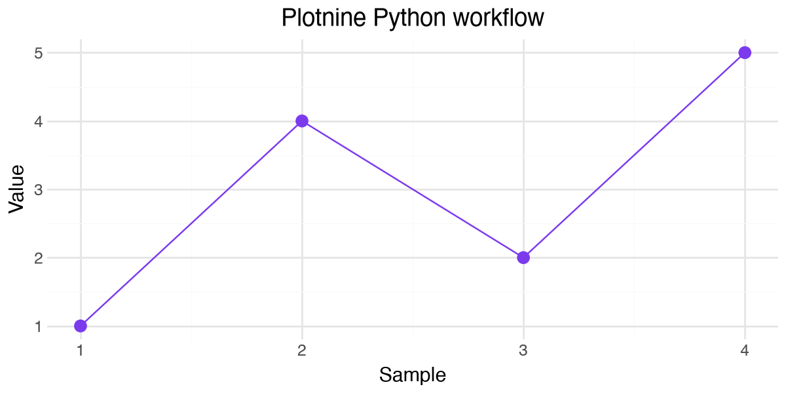

#+TITLE: Jupyter Python and inline plots in Org
#+PROPERTY: header-args:jupyter-python :session org-jupyter-demo :kernel python3 :async no

[[file:../python-workflow.org][Back to the workflow guide]]

Execute blocks in order with C-c C-c. Accept Org's normal confirmation. C-c C-x C-v toggles inline images. This Jupyter kernel has its own namespace, separate from Ghostel and the plain Org Python session.

* Check the kernel
#+begin_src jupyter-python
import sys
jupyter_counter = 40
jupyter_counter + 2
#+end_src

#+RESULTS:
: 42

* Plot directly in Emacs

This inline example uses upstream plotnine.ggplot. The same-window subclass is only needed for native window reuse; no subclass is used in this block.
#+begin_src jupyter-python
%matplotlib inline
values = [1, 4, 2, 5]
import matplotlib.pyplot as plt
import pandas as pd
from plotnine import aes, geom_line, geom_point, ggplot, labs, theme, theme_minimal

data = pd.DataFrame({"sample": range(1, len(values) + 1), "value": values})
p = (
    ggplot(data, aes("sample", "value"))
    + geom_line(color="#7c3aed")
    + geom_point(color="#7c3aed", size=3)
    + labs(title="Plotnine Python workflow", x="Sample", y="Value")
    + theme_minimal()
    + theme(figure_size=(6, 3))
)
p.show()
#+end_src

#+RESULTS:
:RESULTS:
#+attr_org: :width 600 :height 300

:END:

* Confirm state persists
#+begin_src jupyter-python
jupyter_counter += 1
jupyter_counter
#+end_src

#+RESULTS:
: 41
